# 🎨 Awesome Vector Art & SVG Generative Tools ⚡

**Curated Directory of Generative AI Models, Bitmap-to-Vector Tracers, Cloud Studios, Open-Source Vector Editors, and SVG Scripting Runtimes**

*Explore state-of-the-art text-to-SVG generation, Bézier curve vectorization, SVGO performance minification, and programmatic 2D graphics libraries.*

📅 **Last updated: November 2026**

---

## 📑 Table of Contents
- [🌐 Sector Overview & Market Dynamics](#-sector-overview--market-dynamics)
- [☁️ SaaS & Hosted Vector Platforms](#️-saas--hosted-vector-platforms)
- [💻 Open-Source GitHub Projects](#-open-source-github-projects)
- [🤝 How to Contribute](#-how-to-contribute)
- [☕ Support](#-support)
- [📈 Star History](#-star-history)
- [⚖️ Disclaimer](#️-disclaimer)

---

## 🌐 Sector Overview & Market Dynamics

The global vector graphics software and generative AI design market is estimated at **$4.8 billion in 2024**, with projections reaching **$11.2 billion by 2030** at a compound annual growth rate (CAGR) of approximately **15.2%**. This surge is propelled by the integration of multimodal diffusion models, vision-language foundation models (VLMs), and native text-to-SVG synthesis across product branding, web design, UI/UX asset pipelines, and automated digital marketing workflows.

The sector is **moderately fragmented**: incumbent graphic suites (such as Adobe and Corel) and massive collaborative cloud ecosystems (such as Canva and Figma) maintain high market concentration and strong network moats for general design workflows. Concurrently, rapid innovation in specialized AI-driven vector engines (Recraft, Kittl, Vectorizer.AI) and autonomous open-source foundations (Inkscape, Penpot, Graphite, StarVector) prevents a single winner-take-all outcome, fostering an agile ecosystem of specialized tracing algorithms, browser-native editors, and programmatic vector toolkits.

---

## ☁️ SaaS & Hosted Vector Platforms

The table below lists notable cloud-hosted platforms, sorted in descending order by estimated company valuation / annual revenue scale.

| Platform / Product | Category / Primary Capability | Starting Tier Pricing | Free Tier / Trial Limits | Company Scale (Valuation / Revenue) |
| :--- | :--- | :--- | :--- | :--- |
| **[Adobe Illustrator Web & Firefly](https://adobe.com)** | Industry-Standard Cloud Vector Editor & Generative AI | $22.99 / month | 7-day free trial with full access; 25 free monthly Firefly generative credits on free Adobe account | ~$215B Market Cap / ~$21.4B Annual Revenue |
| **[Canva](https://canva.com)** | Cloud Graphic Design, Magic Media Text-to-Vector & SVG Export | $15.00 / month ($120/year) | Free-forever tier with 5 GB cloud storage, 1M+ free assets, and 50 lifetime Magic Media AI generation uses | ~$32B Valuation / ~$2.5B Annual Revenue |
| **[Figma](https://figma.com)** | Collaborative Interface Vector Design & Vector Networks | $12.00 / editor / month | Free-forever Starter tier with 3 active Figma design files, 3 FigJam boards, and unlimited personal drafts | ~$12.5B Valuation / ~$700M Annual ARR |
| **[CorelDRAW Web & Graphics Suite](https://coreldraw.com)** | Professional Vector Illustration & PowerTRACE AI Vectorizer | $22.42 / month ($269/billed annually) | 15-day full-featured free trial with cloud web collaboration and vector export enabled | ~$1.2B Valuation / ~$250M Annual Revenue |
| **[Recraft.ai](https://recraft.ai)** | Generative AI Native Text-to-Vector & Icon Set Generation | $20.00 / month ($240/billed annually) | Free-forever tier with 50 daily generation credits, public gallery visibility, and standard SVG export | ~$350M Valuation / ~$15M ARR |
| **[Linearity Curve](https://linearity.io)** | Precision Vector Design, AI Auto Trace & iPad/Mac Studio | $14.99 / month ($119.88/year) | Free-forever tier with 3 active document files, standard vector pen tools, and 5 AI auto-traces per month | ~$150M Valuation / ~$10M Annual Revenue |
| **[Kittl](https://kittl.com)** | AI Vector Typography, Text Warping & Generative Illustration | $15.00 / month ($120/billed annually) | Free-forever tier with 20 AI generation credits, low-res exports, and 500 MB cloud asset storage | ~$120M Valuation / ~$12M ARR |
| **[Vectorizer.AI](https://vectorizer.ai)** | Deep-Learning Sub-Pixel Raster-to-Vector Conversion API | $9.99 / month (50 web credits + API access) | 5 free preview vectorizations upon registration with interactive side-by-side SVG inspection | ~$25M Valuation / ~$4M Annual Revenue |
| **[SVGator](https://svgator.com)** | Web-Based Keyframe SVG Vector Animation Studio | $18.00 / month ($144/billed annually) | Free-forever tier with 3 project exports per month, static SVG editor, and 10-second timeline cap | ~$15M Valuation / ~$3M Annual Revenue |
| **[Boxy SVG](https://boxy-svg.com)** | Pure Web-Standards SVG Editor & Live XML Code Inspector | $9.99 / year ($0.83/month) | Free-forever web app tier with direct local file system read/write and offline PWA capability | ~$5M Valuation / ~$1M Annual Revenue |
| **[Illustroke](https://illustroke.com)** | Text-to-SVG Generative AI Vector Illustration & Icon Studio | $6.00 one-time (50 illustration credits package) | 3 free lifetime generation tokens upon signup with immediate layered SVG/EPS downloads | ~$2M Valuation / ~$400K Annual Revenue |

---

## 💻 Open-Source GitHub Projects

Curated list of open-source vector engines, generative AI research models, procedural graphics libraries, and web editors. Ranked in descending order by GitHub stargazers count.

| Project & Repository | GitHub Stars Badge | Description & Core Focus |
| :--- | :--- | :--- |
| **[D3.js (d3/d3)](https://github.com/d3/d3)** |  | Dynamic, data-driven procedural SVG, Canvas, and HTML vector visualization framework. |
| **[Penpot (penpot/penpot)](https://github.com)** |  | Open-source design and prototyping platform built natively on web standards (pure SVG & CSS). |
| **[Lottie Web (airbnb/lottie-web)](https://github.com/airbnb/lottie-web)** |  | Native vector animation player rendering Adobe After Effects JSON animations as scalable SVG/Canvas. |
| **[Fabric.js (fabricjs/fabric.js)](https://github.com/fabricjs/fabric.js)** |  | Robust JavaScript 2D graphics library with built-in SVG-to-Canvas parser and interactive object canvas. |
| **[Graphite (GraphiteEditor/Graphite)](https://github.com/GraphiteEditor/Graphite)** |  | Modern 2D vector & raster graphics editor powered by a non-destructive Rust procedural node graph. |
| **[Lucide Icons (lucide-icons/lucide)](https://github.com/lucide-icons/lucide)** |  | Community-crafted library of 2,000+ ultra-clean, customizable 24x24 vector SVG icons. |
| **[SVGO (svg/svgo)](https://github.com/svg/svgo)** |  | Node.js tool and CLI for optimizing and minifying SVG files by stripping metadata and merging paths. |
| **[Tabler Icons (tabler/tabler-icons)](https://github.com/tabler/tabler-icons)** |  | Comprehensive set of over 6,500 MIT-licensed, pixel-perfect SVG vector icons. |
| **[Rough.js (rough-stuff/rough)](https://github.com/rough-stuff/rough)** |  | Lightweight graphics library rendering geometric primitives into sketchy, hand-drawn SVG vector art. |
| **[Paper.js (paperjs/paper.js)](https://github.com/paperjs/paper.js)** |  | The Swiss Army Knife of Vector Graphics Scripting—Bézier path booleans and interactive SVG export. |
| **[SVG.js (svgdotjs/svg.js)](https://github.com/svgdotjs/svg.js)** |  | Zero-dependency, lightweight JavaScript library for generating, manipulating, and animating SVGs. |
| **[VectorCraft (storytold/vectorcraft)](https://github.com/storytold/vectorcraft)** |  | Open-source vector art and SVG generation tool built from scratch in pure Rust. |
| **[Two.js (jonobr1/two.js)](https://github.com/jonobr1/two.js)** |  | Renderer-agnostic 2D drawing API serving identical vector graphics across SVG, Canvas, and WebGL. |
| **[SVG-Edit (SVG-Edit/svgedit)](https://github.com/SVG-Edit/svgedit)** |  | Modular, browser-based JavaScript/HTML5 vector graphics drawing editor and DOM path editor. |
| **[VTracer (visioncortex/vtracer)](https://github.com/visioncortex/vtracer)** |  | Blazing-fast Rust-based raster-to-vector converter transforming bitmaps into crisp, layered SVG files. |
| **[Iconify (iconify/iconify)](https://github.com/iconify/iconify)** |  | Unified vector icon framework providing access to 200,000+ open-source SVG icons across all frameworks. |
| **[SVGOMG (jakearchibald/svgomg)](https://github.com/jakearchibald/svgomg)** |  | Web GUI for SVGO to visually inspect, clean, and download minified SVG code directly in the browser. |
| **[StarVector (joanrod/star-vector)](https://github.com/joanrod/star-vector)** |  | Multimodal foundation model generating structured, editable SVG code directly from images and text. |
| **[resvg (linebender/resvg)](https://github.com/linebender/resvg)** |  | Spec-compliant, memory-safe Rust SVG rendering library and high-speed rasterization CLI tool. |
| **[Inkscape (inkscape/inkscape)](https://github.com/inkscape/inkscape)** |  | Premier open-source professional desktop vector graphics editor supporting full SVG 2.0 specs. |
| **[Canvg (canvg/canvg)](https://github.com/canvg/canvg)** |  | Client-side JavaScript SVG parser that renders SVG paths directly to HTML5 Canvas. |
| **[Method Draw (methodofaction/Method-Draw)](https://github.com/methodofaction/Method-Draw)** |  | Clean, lightweight web-based SVG vector drawing editor running client-side with zero dependencies. |
| **[OmniSVG (OmniSVG/OmniSVG)](https://github.com/OmniSVG/OmniSVG)** |  | End-to-end multimodal SVG generator leveraging vision-language models for complex vector artwork. |
| **[DiffVG (BachiLi/diffvg)](https://github.com/BachiLi/diffvg)** |  | Foundational differentiable vector graphics rasterizer enabling gradient-based optimization for PyTorch. |
| **[svg-mesh-3d (mattdesl/svg-mesh-3d)](https://github.com/mattdesl/svg-mesh-3d)** |  | Triangulates SVG paths into 3D meshes using Constrained Delaunay Triangulation. |
| **[vpype (abey79/vpype)](https://github.com/abey79/vpype)** |  | CLI pipeline and Python utility for sorting, merging, and optimizing complex vector art for plotters. |
| **[p5.js-svg (zenozeng/p5.js-svg)](https://github.com/zenozeng/p5.js-svg)** |  | SVG runtime extension for p5.js enabling creative coders to directly export sketches to SVG files. |
| **[Potrace (skyrpex/potrace)](https://github.com/skyrpex/potrace)** |  | Standalone algorithm and tool for tracing monochrome bitmaps into smooth, scalable Bézier outlines. |
| **[VectorFusion (ximinng/VectorFusion-pytorch)](https://github.com/ximinng/VectorFusion-pytorch)** |  | Text-to-SVG generation pipeline abstracting pixel-based diffusion models via Score Distillation Sampling. |

---

## 🤝 How to Contribute

Contributions are warmly welcome! Whether you are an author of a new open-source SVG model or a user of an exceptional vector SaaS tool, please feel free to contribute:

1. **Fork** the repository 🍴
2. **Create a branch** for your feature or addition (`git checkout -b feature/add-new-vector-tool`) 🌿
3. **Add the tool** with verified pricing, free tier details, or GitHub links ✨
4. **Commit** your changes with clear messages (`git commit -m 'feat: add NewTool to SaaS table'`) 🚀
5. **Open a Pull Request** describing your additions and linking to official sources 📬

---

## ☕ Support

Thank you for exploring and bookmarking this collection! 🌟

If you find this repository valuable for your creative projects, design workflows, or AI research, please consider:
- ⭐ **Starring** the repository on GitHub
- 🍴 **Forking** and contributing new tools
- 📢 **Sharing** with fellow designers, developers, and creative technologists
- ☕ Sponsoring ongoing curation via the [GitHub Sponsor Dashboard](https://github.com/sponsors/ishandutta2007)

---

## 📈 Star History

---

## ⚖️ Disclaimer

*All trademarks, logos, and brand names are the property of their respective owners. Listing does not imply official endorsement or affiliation.*
